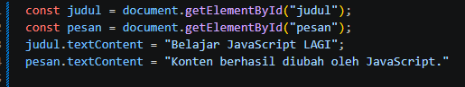

## Latihan 1 — Mengubah teks dengan DOM

<li>gambar diatas merupakan sedikit perubahan text pada DOMnya menjadi lagi</li>

## Latihan 2 — Event click

<li>Perbaruan</li>

## Latihan 3 — Mengubah kelas dan gaya CSS
